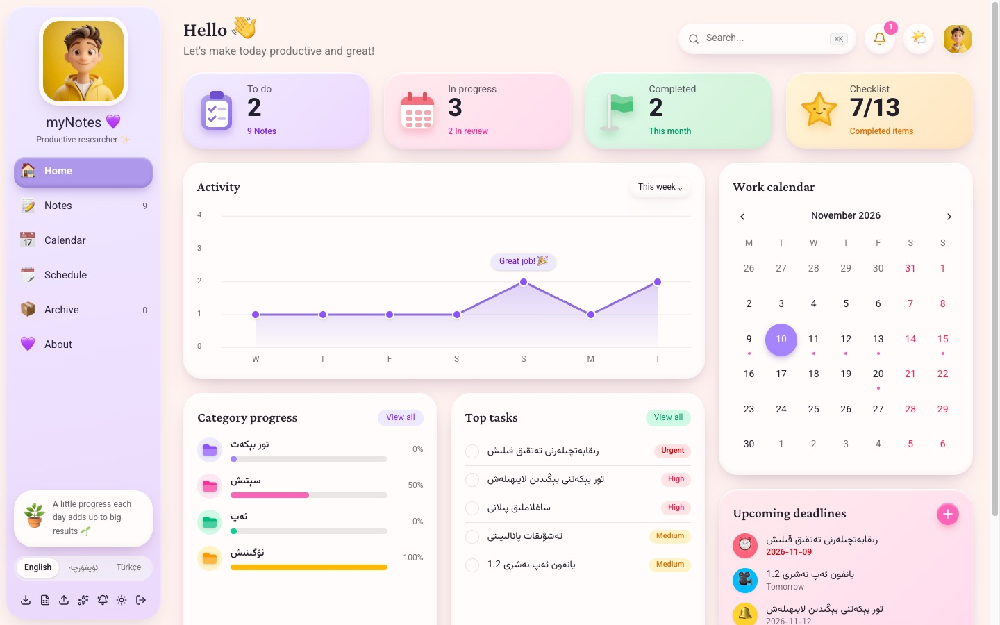
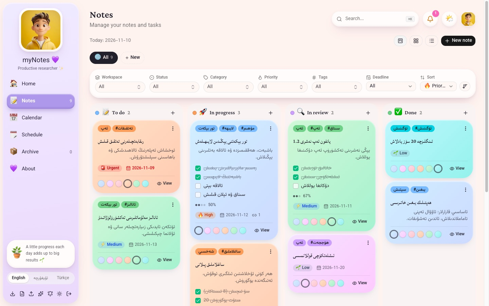
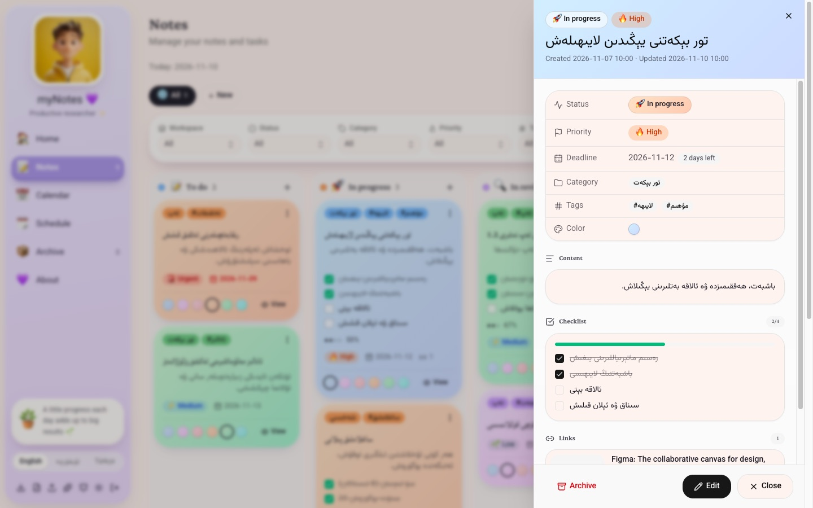
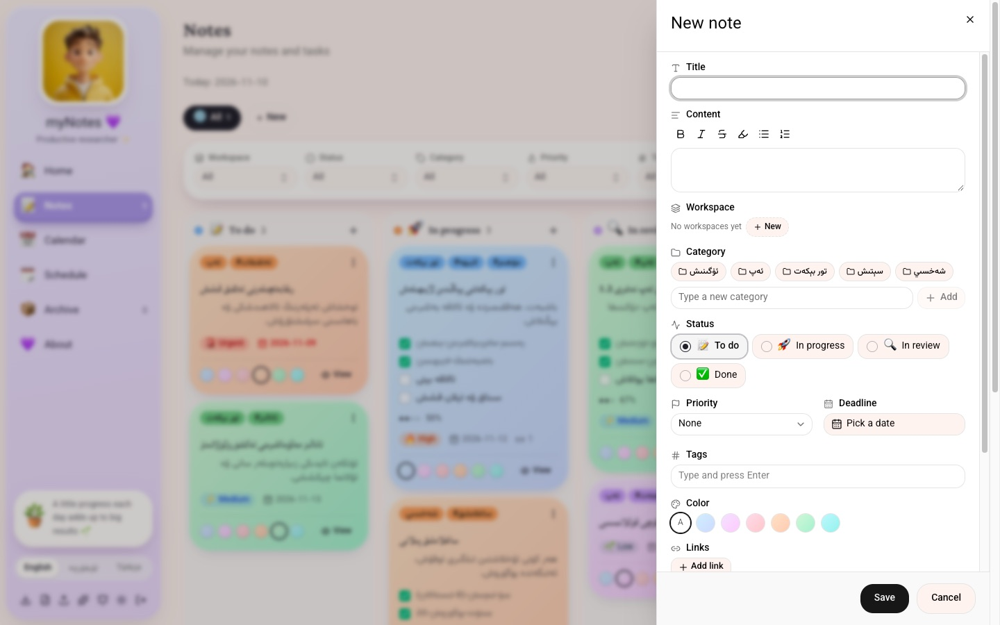
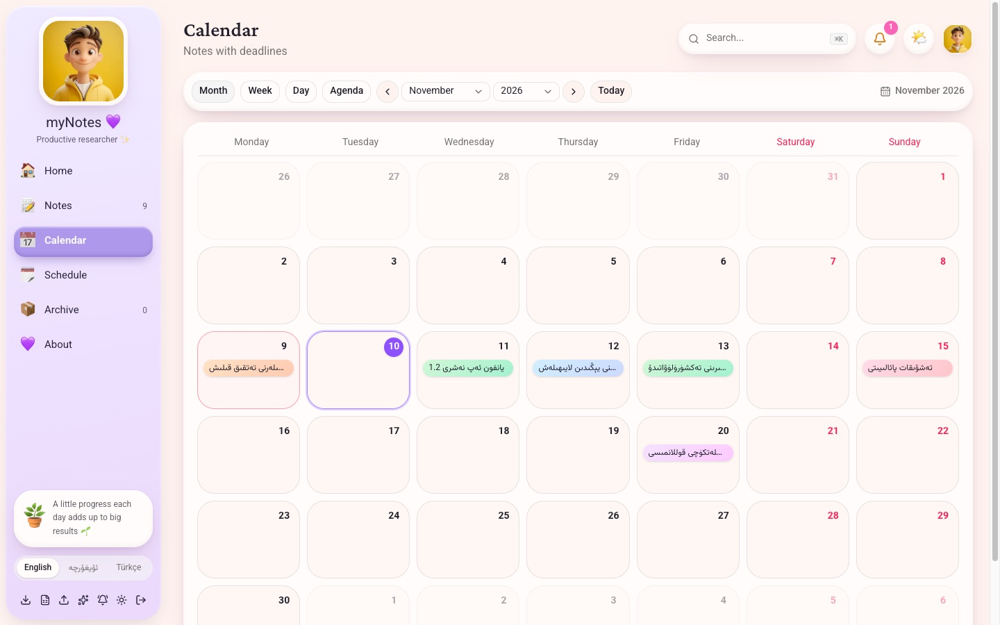
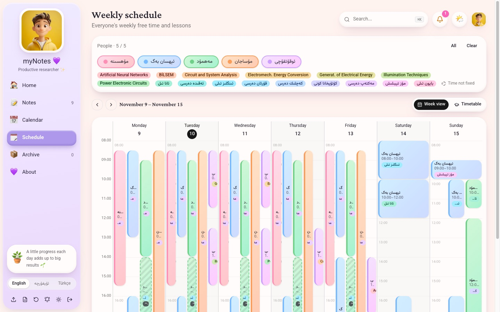
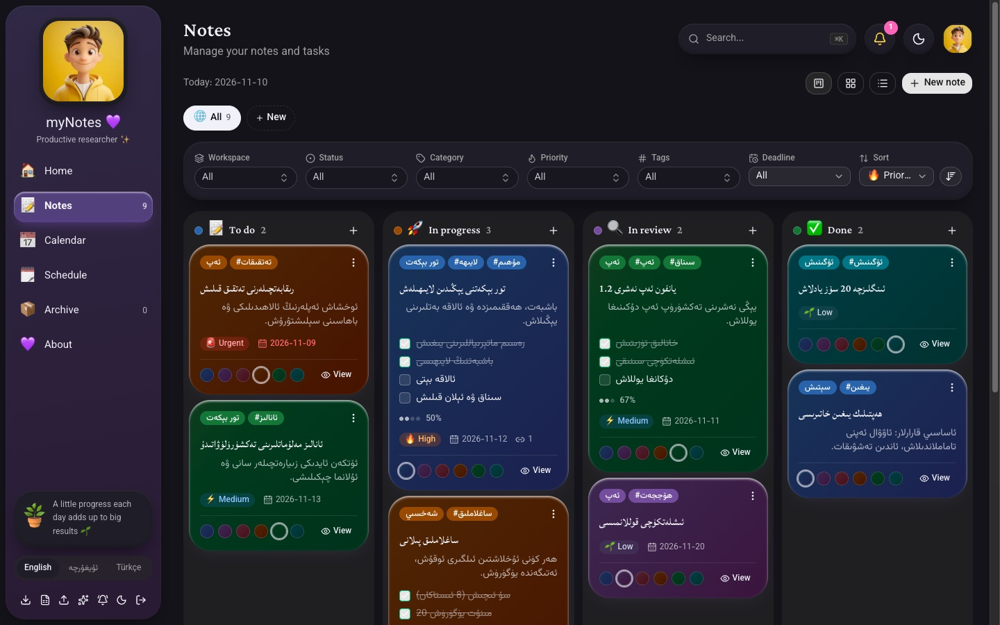
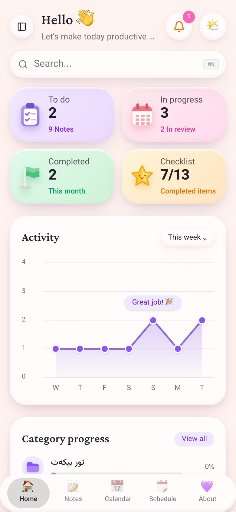
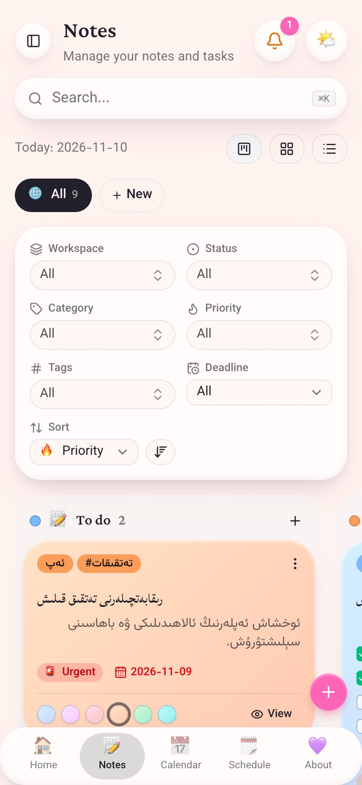
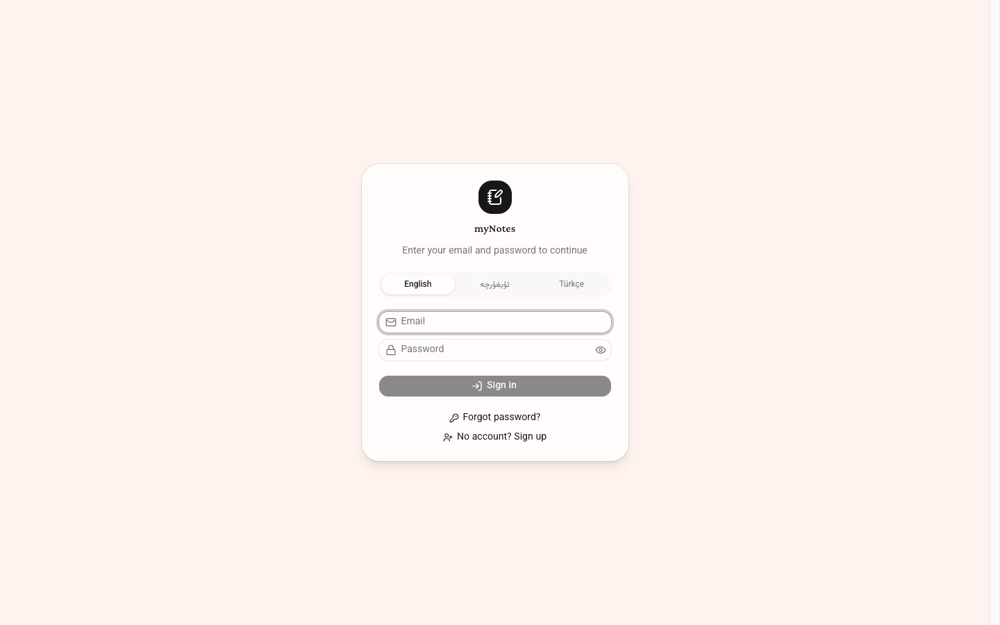

<div align="center">

# 📝 myNotes

**A personal notes, kanban, calendar and weekly-schedule app — Uyghur-first (RTL), with English and Turkish too.**

**English** · [Türkçe](README.tr.md) · [ئۇيغۇرچە](README.ug.md)



</div>

---

## Contents

- [Features](#features)
- [Screenshots](#screenshots)
- [Tech stack](#tech-stack)
- [Getting started](#getting-started)
- [Supabase setup](#supabase-setup)
- [Push reminders](#push-reminders)
- [How it works](#how-it-works)
- [Languages and RTL](#languages-and-rtl)
- [Project structure](#project-structure)
- [Scripts and tests](#scripts-and-tests)
- [Deployment](#deployment)
- [Security notes](#security-notes)
- [Development notes](#development-notes)

## Features

**Notes**
- Three views: **kanban** (drag and drop between columns), **cards** and **list**.
- Four statuses (*To do → In progress → In review → Done*), four priorities, deadlines, categories, tags and a colour per note.
- Rich text in the note body: **bold**, *italic*, ~~strikethrough~~, ==highlight==, bullet and numbered lists.
- Checklists with progress, links, and **image / PDF attachments** (private Supabase Storage bucket).
- Filter by workspace, status, category, priority, tags and deadline; sort by last update, deadline, priority, title or **manual order** (drag and drop in the card and kanban views).
- **Workspaces** (a top-level grouping such as *Personal*, *School*, *Project*) shown as tabs.
- **Archive** instead of deleting: archived notes can be restored later.
- Global search / command palette (`⌘K` / `Ctrl K`).
- Import and export as **JSON** or **CSV**.

**Dashboard**
- Counters (to do / in progress / completed / checklist items), a weekly activity chart, a work calendar, upcoming deadlines, per-category progress and top tasks.
- One-click demo notes for an empty account.

**Calendar**
- *Month*, *Week*, *Day* and *Agenda* views of every note that has a deadline, with quick "add a note for this day".

**Weekly schedule**
- People and their recurring weekly lessons, each with a period, skipped days, an optional "flexible time" flag and notes.
- Shows **common free time** for the people you select, adds **travel time** before the first and after the last lesson of the day.
- *Week* and *Timetable* views, CSV import / export, synced in real time across devices.

**Reminders (Web Push)**
- Account-wide **deadline reminders** (e.g. on the due date and 1 day before, at a time you choose).
- Per-note **alarms** with an exact date and time and optional repetition (every *n* minutes / hours / days / weeks / months).
- Works while the app is closed; notifications open the note directly.

**Everything else**
- Email + password accounts with email confirmation and password reset.
- Light / dark / system theme, installable as a PWA, mobile bottom navigation and swipe-to-close side panels.
- Resizable desktop side panel for viewing and editing notes.
- Three UI languages — Uyghur (RTL), English, Turkish — switchable at any time.

## Screenshots

### Notes board



### Note detail and editor

<p>
  
  
</p>

### Calendar and weekly schedule

<p>
  
  
</p>

### Dark theme



### Mobile

<p align="center">
  
  &nbsp;&nbsp;
  
  &nbsp;&nbsp;
  
</p>

> The screenshots use the built-in demo notes and the default demo schedule; no real account or data was used.

## Tech stack

| Area | Technology |
| --- | --- |
| Framework | [Next.js](https://nextjs.org) 16 (App Router, `cacheComponents`, Turbopack), React 19, TypeScript |
| Styling / UI | Tailwind CSS v4, shadcn/ui on [Base UI](https://base-ui.com), lucide-react, sonner, next-themes |
| Backend | [Supabase](https://supabase.com): Postgres + Row Level Security, Auth, Storage, Realtime, Edge Functions, `pg_cron` |
| Client libraries | `@supabase/supabase-js`, `@dnd-kit` (drag and drop), `cmdk`, `date-fns`, `react-day-picker`, `zod` |
| Push | Web Push (VAPID) via a service worker and a Supabase Edge Function (Deno) |

## Getting started

**Requirements:** Node.js 20.9 or newer and a free [Supabase](https://supabase.com) project.

```bash
git clone <your-fork-or-this-repo-url> myNotes
cd myNotes
npm install
cp .env.example .env.local     # then fill in the values below
npm run dev                    # http://localhost:3000
```

### Environment variables

| Variable | Required | Description |
| --- | --- | --- |
| `NEXT_PUBLIC_SUPABASE_URL` | yes | Supabase → *Project Settings → API* → Project URL |
| `NEXT_PUBLIC_SUPABASE_ANON_KEY` | yes | The **anon / public** key only. Never put the `service_role` key here — it bypasses RLS |
| `NEXT_PUBLIC_VAPID_PUBLIC_KEY` | for push | Generate a pair with `npx web-push generate-vapid-keys`. Only the **public** key goes here |

Without the Supabase variables the app shows the sign-in screen with a "not configured" message.

## Supabase setup

1. Create a project, then enable **Email** under *Authentication → Providers*.
2. Under *Authentication → URL Configuration* set the **Site URL** (and redirect URLs) to where the app runs, so confirmation and password-reset links come back to it.
3. Open the **SQL Editor** and run the files in [`supabase/migrations/`](supabase/migrations) **in order**:

| File | What it does |
| --- | --- |
| `0001_init.sql` | `notes`, `schedule_people`, `schedule_lessons`, the private `attachments` bucket, RLS policies |
| `0002_schedule_realtime.sql` | Adds the schedule tables to Realtime |
| `0003_workspaces.sql` | Workspaces and `notes.workspace_id`; moves existing notes into a default workspace |
| `0004_archive.sql` | `notes.archived_at` for the archive |
| `0005_reminders.sql` | Push subscriptions, reminder settings and the sent-log (+ `pg_cron` example) |
| `0006_note_reminders.sql` | Per-note alarms (`notes.reminders`) and log cleanup |
| `0007_email_exists.sql` | `email_exists()` so the password-reset form can tell whether an account exists |
| `0008_rls_initplan.sql` | Faster RLS policies (`(select auth.uid())` is evaluated once per query) |

The browser client uses only the anon key. Every table has RLS, so a user can read and write **only their own rows**; attachments live in `attachments/{user_id}/{attachment_id}`.

## Push reminders

Two kinds of reminders are sent by the [`send-reminders`](supabase/functions/send-reminders) Edge Function, called by `pg_cron` every minute:

- **Deadline reminders** — account-wide settings (days before the deadline + time of day + time zone).
- **Note alarms** — an exact date/time per note, optionally repeating.

```bash
# 1) Deploy the function (it verifies the caller itself: cron secret or the user's JWT)
supabase functions deploy send-reminders --no-verify-jwt

# 2) Secrets
supabase secrets set \
  VAPID_PUBLIC_KEY=...  VAPID_PRIVATE_KEY=...  VAPID_SUBJECT=mailto:you@example.com \
  CRON_SECRET=...
```

3. Enable the `pg_cron` and `pg_net` extensions (*Database → Extensions*).
4. Store the same secret in Vault: `select vault.create_secret('<same-secret>', 'reminders_cron_secret');`
5. Run the `cron.schedule('send-reminders', '* * * * *', …)` example from `0006_note_reminders.sql`, replacing `<project-ref>` with your project reference.

From the app: sidebar → **Reminders** → turn notifications on, pick the days and time, and press *Send a test notification*. On iPhone, add the app to the Home Screen first (iOS only delivers web push to installed web apps).

> `due.ts` and `occurrence.ts` are shared between the Edge Function and the browser, so they **must stay import-free**.

## How it works

- **Notes sync** — `lib/notes-store.tsx` keeps an optimistic reducer; changes are diffed against the last server snapshot and upserted in chunks. Supabase Realtime pushes changes from other devices.
- **Schedule and workspaces** — `lib/schedule-store.ts` and `lib/workspaces-store.ts` follow the same diff-and-sync idea with Realtime.
- **Attachments** — `lib/blobs.ts` uploads to Supabase Storage and caches downloads in IndexedDB.
- **First sign-in** — an empty account gets demo notes once (a flag in the user's metadata prevents re-adding them).
- **UI preferences** (view mode, sort, filters, panel width, language) are kept in `localStorage`.
- **Service worker** — `public/sw.js` handles push only; it deliberately does no caching, so users never see a stale page.

## Languages and RTL

All UI strings live in [`lib/i18n/`](lib/i18n): `ug.ts` (Uyghur, the source of the `Messages` type), `en.ts` and `tr.ts`. When you add a string, add it to **all three** files — TypeScript will complain if one is missing.

Uyghur renders right-to-left; English and Turkish left-to-right. The saved language is applied to `<html lang dir>` by an inline script *before* the first paint, so the page never flashes in the wrong direction. Layout uses logical properties (`ms-*`, `pe-*`, `text-start`, …) so it mirrors automatically; the side panel opens from the left in RTL and from the right in LTR.

## Project structure

```
app/                    Next.js App Router
  (app)/                Signed-in pages: / (dashboard), notes, calendar, schedule, archive, about
  api/og/               Open Graph image
  manifest.ts           PWA manifest
components/
  auth/                 Sign in / sign up / password reset, AuthGate
  notes/                Feature components (kanban, cards, list, dialogs, calendar, schedule, …)
  ui/                   shadcn/ui primitives, SidePanel
hooks/                  Small React hooks
lib/
  i18n/                 ug / en / tr messages
  notes-*.ts(x)         Notes store + Supabase repo
  schedule-*.ts         Schedule store, repo, CSV
  supabase/client.ts    Browser-only Supabase client
public/                 Icons, service worker
supabase/
  migrations/           SQL, run in order
  functions/send-reminders/   Edge Function + shared date logic + tests
docs/screenshots/       README images (ug / en / tr)
```

## Scripts and tests

| Command | Purpose |
| --- | --- |
| `npm run dev` | Development server on port 3000 |
| `npm run build` | Production build |
| `npm start` | Serve the production build |
| `npm run lint` | ESLint |
| `node --test supabase/functions/send-reminders/*.test.ts` | Unit tests for the reminder logic (needs Node 22.18+ or 23.6+, which run TypeScript directly) |

There is no test runner configured for the front end.

## Deployment

It is a standard Next.js app: connect the repository to Railway, Vercel or any Node host, set the three `NEXT_PUBLIC_*` variables, and run `npm run build` / `npm start`. The version shown in the app is `major.minor` from `package.json` plus the git commit count (override with `APP_VERSION`).

## Security notes

- Only the **anon** key is ever shipped to the browser; data is protected by **Row Level Security**.
- The `send-reminders` function is deployed with `--no-verify-jwt` and authenticates requests itself (`x-cron-secret` for cron, a user JWT for test notifications). Keep `CRON_SECRET` and the VAPID **private** key in Edge Function secrets only.
- `email_exists()` lets the password-reset form say whether an account exists. That makes account enumeration possible — remove migration `0007` and the related UI if you prefer Supabase's neutral behaviour.

## Development notes

- This project uses a Next.js version with breaking changes compared with most documentation. Read the relevant guide in `node_modules/next/dist/docs/` before writing Next.js code (see [AGENTS.md](AGENTS.md)).
- `cacheComponents` and `partialPrefetching` are enabled in [`next.config.ts`](next.config.ts); check the docs before adding data fetching or dynamic APIs.
- Tailwind runs through Turbopack (`turbopack.rules` in `next.config.ts`) instead of the usual PostCSS config; styles are in `app/globals.css`.
- `html` always shows a vertical scrollbar (`overflow-y: scroll !important`) and `PageScrollGuard` blocks page scrolling while a dialog is open, so opening dialogs, selects or panels never makes the layout jump.
