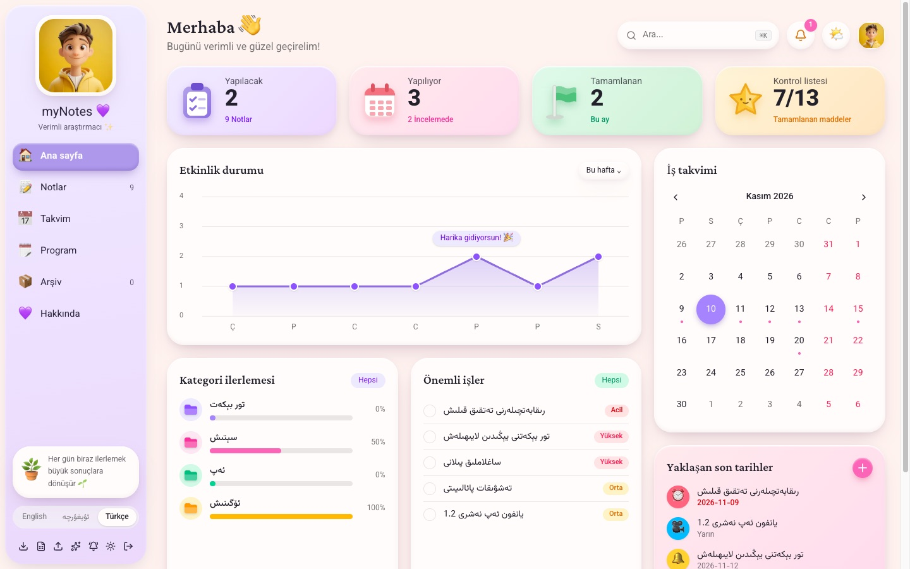
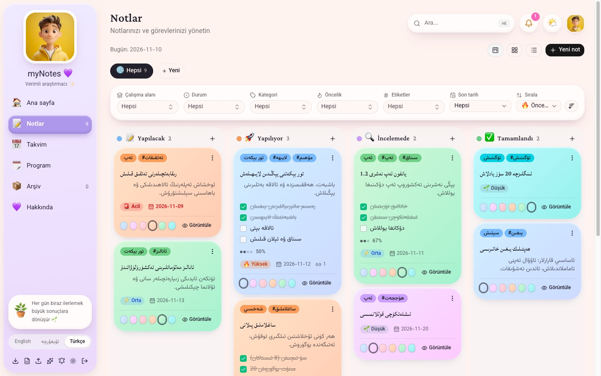
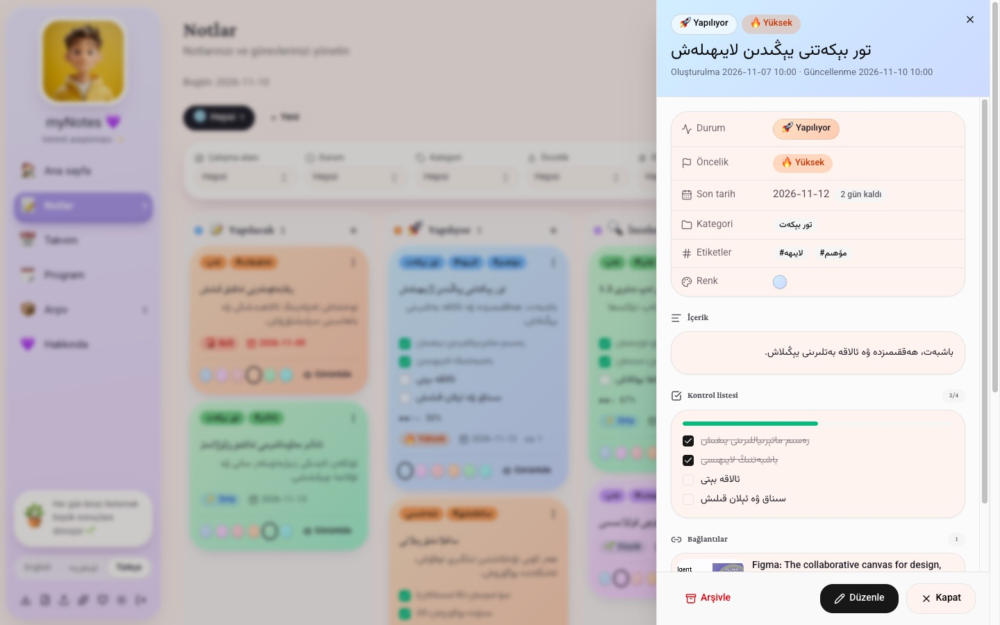
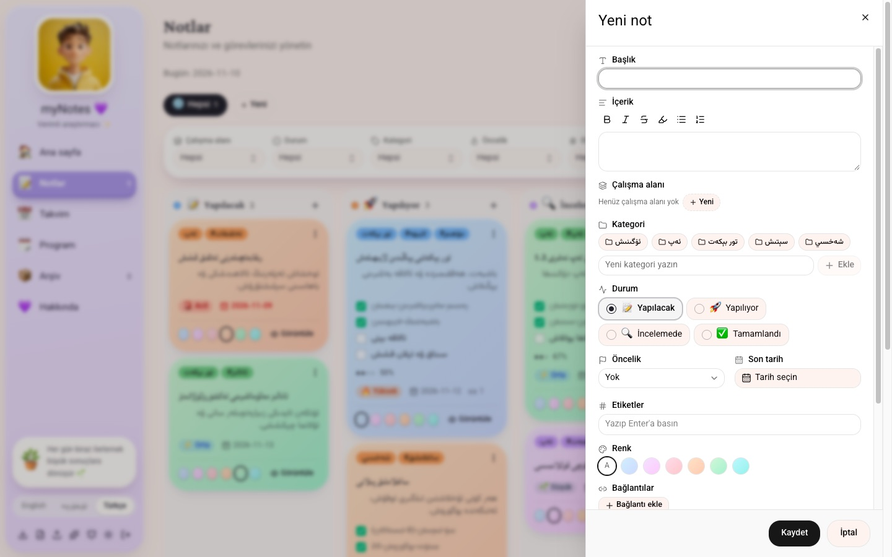
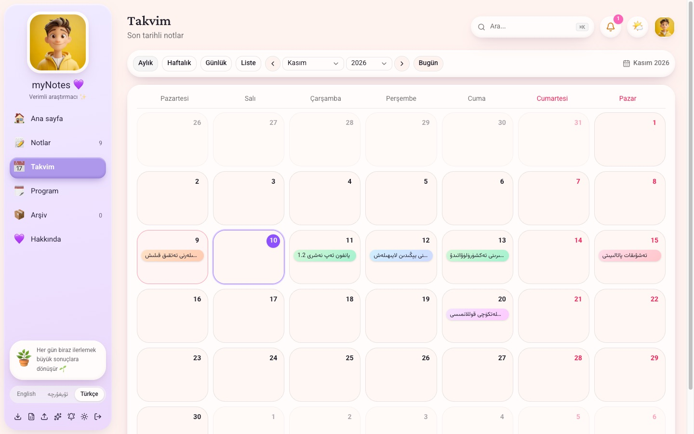
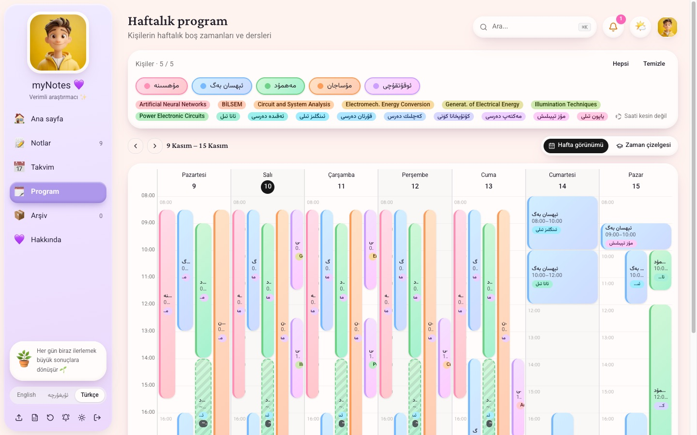
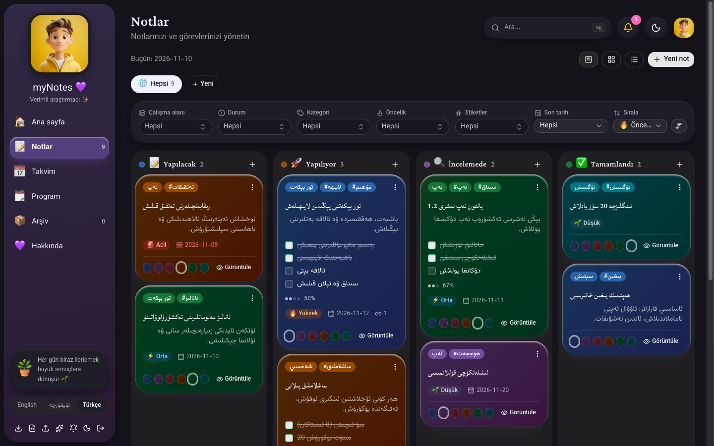
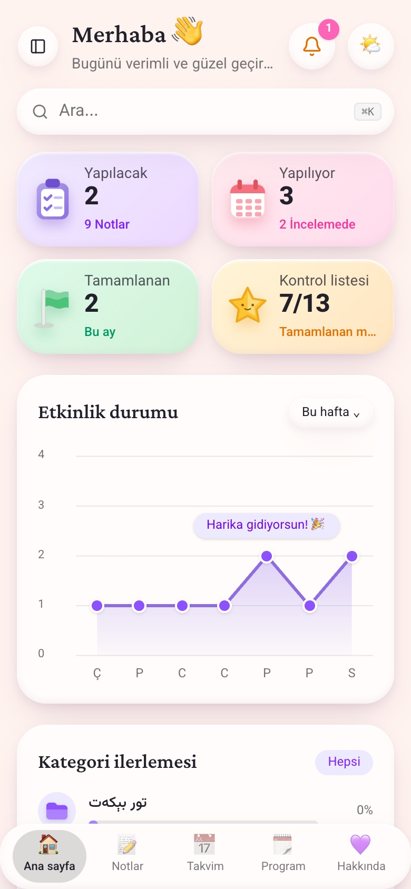
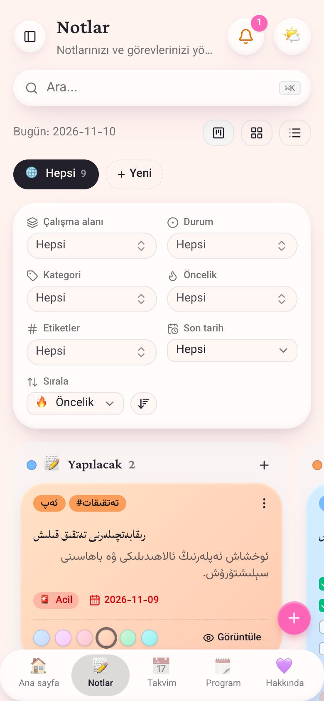
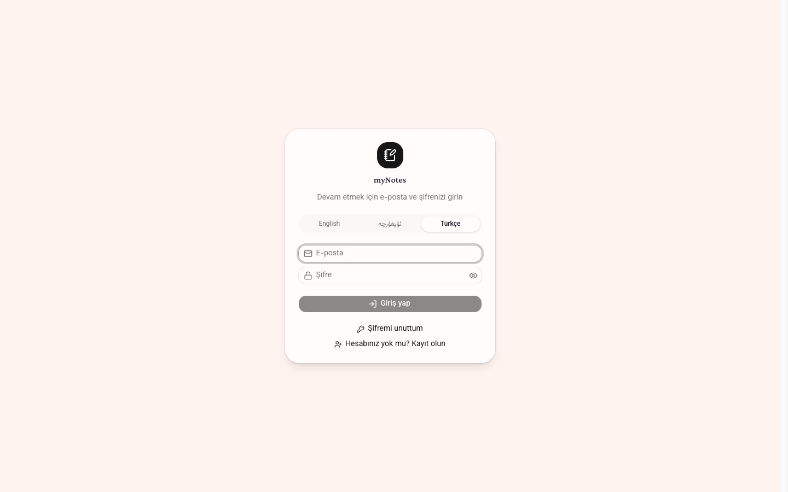

<div align="center">

# 📝 myNotes

**Kişisel not, kanban, takvim ve haftalık program uygulaması — Uygurca (RTL) öncelikli; İngilizce ve Türkçe de destekli.**

[English](README.md) · **Türkçe** · [ئۇيغۇرچە](README.ug.md)



</div>

---

## İçindekiler

- [Özellikler](#özellikler)
- [Ekran görüntüleri](#ekran-görüntüleri)
- [Teknolojiler](#teknolojiler)
- [Kurulum](#kurulum)
- [Supabase kurulumu](#supabase-kurulumu)
- [Push hatırlatmalar](#push-hatırlatmalar)
- [Nasıl çalışır?](#nasıl-çalışır)
- [Diller ve RTL](#diller-ve-rtl)
- [Proje yapısı](#proje-yapısı)
- [Komutlar ve testler](#komutlar-ve-testler)
- [Yayına alma](#yayına-alma)
- [Güvenlik notları](#güvenlik-notları)
- [Geliştirme notları](#geliştirme-notları)

## Özellikler

**Notlar**
- Üç görünüm: **kanban** (sütunlar arası sürükle-bırak), **kart** ve **liste**.
- Dört durum (*Yapılacak → Yapılıyor → İncelemede → Tamamlandı*), dört öncelik, son tarih, kategori, etiket ve her nota bir renk.
- Not içeriğinde zengin metin: **kalın**, *italik*, ~~üstü çizili~~, ==vurgulu==, madde işaretli ve numaralı listeler.
- İlerleme gösteren kontrol listeleri, bağlantılar ve **görsel / PDF ekleri** (özel Supabase Storage bucket'ı).
- Çalışma alanı, durum, kategori, öncelik, etiket ve son tarihe göre filtreleme; son güncelleme, son tarih, öncelik, başlık veya **elle sıralama** (kart ve kanban görünümlerinde sürükle-bırak) ile sıralama.
- **Çalışma alanları**: üst kategori (ör. *Kişisel*, *Okul*, *Proje*); sekme olarak gösterilir.
- Silmek yerine **arşivleme**; arşivlenen not sonra geri alınabilir.
- Genel arama / komut paleti (`⌘K` / `Ctrl K`).
- **JSON** veya **CSV** olarak içe / dışa aktarma.

**Ana sayfa (dashboard)**
- Sayaçlar (yapılacak / yapılıyor / tamamlanan / kontrol listesi maddeleri), haftalık etkinlik grafiği, iş takvimi, yaklaşan son tarihler, kategori ilerlemesi ve öne çıkan görevler.
- Boş hesap için tek tıkla demo notlar.

**Takvim**
- Son tarihi olan tüm notların *Aylık*, *Haftalık*, *Günlük* ve *Liste* görünümleri; "bu güne not ekle" kısayolu.

**Haftalık program**
- Kişiler ve her hafta tekrar eden dersleri: dönem aralığı, atlanan günler, isteğe bağlı "saati belirsiz" işareti ve not.
- Seçilen kişiler için **ortak boş zamanı** gösterir; her günün ilk dersinden önce ve son dersinden sonra **yol süresi** ekler.
- *Hafta görünümü* ve *Zaman çizelgesi*, CSV içe / dışa aktarma ve cihazlar arası gerçek zamanlı eşitleme.

**Hatırlatmalar (Web Push)**
- Hesap genelinde **son tarih hatırlatmaları** (ör. son gün ve 1 gün önce, seçtiğin saatte).
- Not başına **alarmlar**: kesin tarih-saat ve isteğe bağlı tekrar (her *n* dakika / saat / gün / hafta / ay).
- Uygulama kapalıyken de çalışır; bildirime tıklayınca ilgili not açılır.

**Diğer**
- E-posta + şifre ile hesap, e-posta doğrulama ve şifre sıfırlama.
- Açık / koyu / sistem teması, PWA olarak yüklenebilir, mobilde alt gezinme ve kaydırarak kapanan yan paneller.
- Masaüstünde genişliği ayarlanabilir yan panel.
- Üç arayüz dili — Uygurca (RTL), İngilizce, Türkçe — istediğin an değiştirilebilir.

## Ekran görüntüleri

### Not panosu



### Not detayı ve düzenleyici

<p>
  
  
</p>

### Takvim ve haftalık program

<p>
  
  
</p>

### Koyu tema



### Mobil

<p align="center">
  
  &nbsp;&nbsp;
  
  &nbsp;&nbsp;
  
</p>

> Ekran görüntülerinde uygulamanın yerleşik demo notları ve varsayılan demo programı kullanıldı; gerçek hesap veya veri kullanılmadı.

## Teknolojiler

| Alan | Teknoloji |
| --- | --- |
| Çatı | [Next.js](https://nextjs.org) 16 (App Router, `cacheComponents`, Turbopack), React 19, TypeScript |
| Stil / arayüz | Tailwind CSS v4, [Base UI](https://base-ui.com) üzerinde shadcn/ui, lucide-react, sonner, next-themes |
| Arka uç | [Supabase](https://supabase.com): Postgres + Row Level Security, Auth, Storage, Realtime, Edge Functions, `pg_cron` |
| İstemci kütüphaneleri | `@supabase/supabase-js`, `@dnd-kit` (sürükle-bırak), `cmdk`, `date-fns`, `react-day-picker`, `zod` |
| Push | Service worker ve Supabase Edge Function (Deno) ile Web Push (VAPID) |

## Kurulum

**Gereksinimler:** Node.js 20.9 veya üzeri ve ücretsiz bir [Supabase](https://supabase.com) projesi.

```bash
git clone <fork-veya-bu-reponun-adresi> myNotes
cd myNotes
npm install
cp .env.example .env.local     # aşağıdaki değerleri doldur
npm run dev                    # http://localhost:3000
```

### Ortam değişkenleri

| Değişken | Zorunlu | Açıklama |
| --- | --- | --- |
| `NEXT_PUBLIC_SUPABASE_URL` | evet | Supabase → *Project Settings → API* → Project URL |
| `NEXT_PUBLIC_SUPABASE_ANON_KEY` | evet | Yalnızca **anon / public** anahtar. `service_role` anahtarını buraya asla koyma — RLS'yi aşar |
| `NEXT_PUBLIC_VAPID_PUBLIC_KEY` | push için | `npx web-push generate-vapid-keys` ile çift üret. Buraya yalnızca **public** anahtar yazılır |

Supabase değişkenleri yoksa uygulama "yapılandırılmamış" uyarısıyla giriş ekranını gösterir.

## Supabase kurulumu

1. Proje oluştur, *Authentication → Providers* altında **Email**'i aç.
2. *Authentication → URL Configuration* altında **Site URL**'yi (ve yönlendirme adreslerini) uygulamanın çalıştığı adrese ayarla; böylece doğrulama ve şifre sıfırlama bağlantıları uygulamaya döner.
3. **SQL Editor**'ü aç ve [`supabase/migrations/`](supabase/migrations) içindeki dosyaları **sırayla** çalıştır:

| Dosya | Ne yapar? |
| --- | --- |
| `0001_init.sql` | `notes`, `schedule_people`, `schedule_lessons`, özel `attachments` bucket'ı, RLS politikaları |
| `0002_schedule_realtime.sql` | Program tablolarını Realtime'a ekler |
| `0003_workspaces.sql` | Çalışma alanları ve `notes.workspace_id`; mevcut notları varsayılan çalışma alanına taşır |
| `0004_archive.sql` | Arşiv için `notes.archived_at` |
| `0005_reminders.sql` | Push abonelikleri, hatırlatma ayarları ve gönderim günlüğü (+ `pg_cron` örneği) |
| `0006_note_reminders.sql` | Not başına alarmlar (`notes.reminders`) ve günlük temizliği |
| `0007_email_exists.sql` | Şifre sıfırlama formunun hesap olup olmadığını söyleyebilmesi için `email_exists()` |
| `0008_rls_initplan.sql` | Daha hızlı RLS politikaları (`(select auth.uid())` sorgu başına bir kez hesaplanır) |

Tarayıcı istemcisi yalnızca anon anahtarı kullanır. Her tabloda RLS vardır; kullanıcı **yalnızca kendi satırlarını** okuyup yazabilir. Ekler `attachments/{user_id}/{attachment_id}` yolunda tutulur.

## Push hatırlatmalar

İki tür hatırlatmayı, `pg_cron` tarafından her dakika çağrılan [`send-reminders`](supabase/functions/send-reminders) Edge Function'ı gönderir:

- **Son tarih hatırlatmaları** — hesap genelinde ayar (son tarihten kaç gün önce + günün saati + saat dilimi).
- **Not alarmları** — her not için kesin tarih/saat, isteğe bağlı tekrar.

```bash
# 1) Fonksiyonu yayınla (çağıranı kendisi doğrular: cron secret veya kullanıcının JWT'si)
supabase functions deploy send-reminders --no-verify-jwt

# 2) Secret'lar
supabase secrets set \
  VAPID_PUBLIC_KEY=...  VAPID_PRIVATE_KEY=...  VAPID_SUBJECT=mailto:sen@example.com \
  CRON_SECRET=...
```

3. `pg_cron` ve `pg_net` eklentilerini aç (*Database → Extensions*).
4. Aynı gizli değeri Vault'a kaydet: `select vault.create_secret('<ayni-gizli-deger>', 'reminders_cron_secret');`
5. `0006_note_reminders.sql` içindeki `cron.schedule('send-reminders', '* * * * *', …)` örneğini çalıştır; `<project-ref>` yerine kendi proje referansını yaz.

Uygulamada: kenar çubuğu → **Hatırlatmalar** → bildirimleri aç, günleri ve saati seç, *Test bildirimi gönder*'e bas. iPhone'da önce uygulamayı Ana Ekran'a ekle (iOS web push'u yalnızca yüklü web uygulamalarına iletir).

> `due.ts` ve `occurrence.ts` Edge Function ile tarayıcı arasında paylaşılır; bu yüzden **hiçbir import içermemelidir**.

## Nasıl çalışır?

- **Not eşitleme** — `lib/notes-store.tsx` iyimser (optimistic) bir reducer tutar; değişiklikler son sunucu anlık görüntüsüyle karşılaştırılıp parçalar hâlinde `upsert` edilir. Diğer cihazlardaki değişiklikler Supabase Realtime ile gelir.
- **Program ve çalışma alanları** — `lib/schedule-store.ts` ve `lib/workspaces-store.ts` aynı "fark al ve eşitle" mantığını Realtime ile kullanır.
- **Ekler** — `lib/blobs.ts` Supabase Storage'a yükler, indirilenleri IndexedDB'de önbelleğe alır.
- **İlk giriş** — boş hesaba bir kez demo notlar eklenir (kullanıcı metadata'sındaki bir bayrak tekrar eklenmesini önler).
- **Arayüz tercihleri** (görünüm, sıralama, filtreler, panel genişliği, dil) `localStorage`'da tutulur.
- **Service worker** — `public/sw.js` yalnızca push'u yönetir; bilerek önbellek yapmaz, böylece eski sayfa görünmez.

## Diller ve RTL

Tüm arayüz metinleri [`lib/i18n/`](lib/i18n) içindedir: `ug.ts` (Uygurca, `Messages` tipinin kaynağı), `en.ts` ve `tr.ts`. Yeni bir metin eklerken **üç dosyaya da** ekle — biri eksikse TypeScript uyarır.

Uygurca sağdan sola, İngilizce ve Türkçe soldan sağa çizilir. Kayıtlı dil, ilk çizimden *önce* satır içi bir betikle `<html lang dir>` üzerine yazılır; bu yüzden sayfa yanlış yönde yanıp sönmez. Yerleşim mantıksal özellikleri (`ms-*`, `pe-*`, `text-start`, …) kullandığı için kendiliğinden aynalanır; yan panel RTL'de soldan, LTR'de sağdan açılır.

## Proje yapısı

```
app/                    Next.js App Router
  (app)/                Giriş yapılmış sayfalar: / (ana sayfa), notes, calendar, schedule, archive, about
  api/og/               Open Graph görseli
  manifest.ts           PWA manifestosu
components/
  auth/                 Giriş / kayıt / şifre sıfırlama, AuthGate
  notes/                Özellik bileşenleri (kanban, kart, liste, diyaloglar, takvim, program, …)
  ui/                   shadcn/ui bileşenleri, SidePanel
hooks/                  Küçük React hook'ları
lib/
  i18n/                 ug / en / tr metinleri
  notes-*.ts(x)         Not store'u + Supabase repo'su
  schedule-*.ts         Program store'u, repo'su, CSV
  supabase/client.ts    Yalnızca tarayıcıda çalışan Supabase istemcisi
public/                 Simgeler, service worker
supabase/
  migrations/           SQL, sırayla çalıştırılır
  functions/send-reminders/   Edge Function + ortak tarih mantığı + testler
docs/screenshots/       README görselleri (ug / en / tr)
```

## Komutlar ve testler

| Komut | Amaç |
| --- | --- |
| `npm run dev` | 3000 portunda geliştirme sunucusu |
| `npm run build` | Üretim derlemesi |
| `npm start` | Üretim derlemesini sunar |
| `npm run lint` | ESLint |
| `node --test supabase/functions/send-reminders/*.test.ts` | Hatırlatma mantığı birim testleri (TypeScript'i doğrudan çalıştıran Node 22.18+ veya 23.6+ gerekir) |

Ön yüz için yapılandırılmış bir test çalıştırıcısı yoktur.

## Yayına alma

Standart bir Next.js uygulamasıdır: repoyu Railway, Vercel veya herhangi bir Node barındırıcısına bağla, üç `NEXT_PUBLIC_*` değişkenini ayarla ve `npm run build` / `npm start` çalıştır. Uygulamada görünen sürüm, `package.json`'daki `major.minor` ile git commit sayısından oluşur (`APP_VERSION` ile değiştirilebilir).

## Güvenlik notları

- Tarayıcıya yalnızca **anon** anahtar gider; veriyi **Row Level Security** korur.
- `send-reminders` fonksiyonu `--no-verify-jwt` ile yayınlanır ve istekleri kendisi doğrular (cron için `x-cron-secret`, test bildirimi için kullanıcı JWT'si). `CRON_SECRET` ve VAPID **private** anahtarını yalnızca Edge Function secret'larında tut.
- `email_exists()`, şifre sıfırlama formunun hesap olup olmadığını söylemesini sağlar. Bu, hesap varlığının sorgulanabilmesi demektir — Supabase'in nötr davranışını tercih edersen `0007` migration'ını ve ilgili arayüzü kaldır.

## Geliştirme notları

- Bu proje, çoğu dokümana göre kırıcı değişiklikler içeren bir Next.js sürümü kullanır. Next.js kodu yazmadan önce `node_modules/next/dist/docs/` içindeki ilgili kılavuzu oku ([AGENTS.md](AGENTS.md)).
- [`next.config.ts`](next.config.ts) içinde `cacheComponents` ve `partialPrefetching` açıktır; veri çekme veya dinamik API eklemeden önce dokümanlara bak.
- Tailwind, olağan PostCSS yapılandırması yerine Turbopack üzerinden çalışır (`next.config.ts` içindeki `turbopack.rules`); stiller `app/globals.css` içindedir.
- `html` her zaman dikey kaydırma çubuğu gösterir (`overflow-y: scroll !important`) ve bir diyalog açıkken `PageScrollGuard` sayfa kaydırmasını engeller; böylece diyalog, seçim kutusu veya panel açılınca yerleşim kaymaz.
