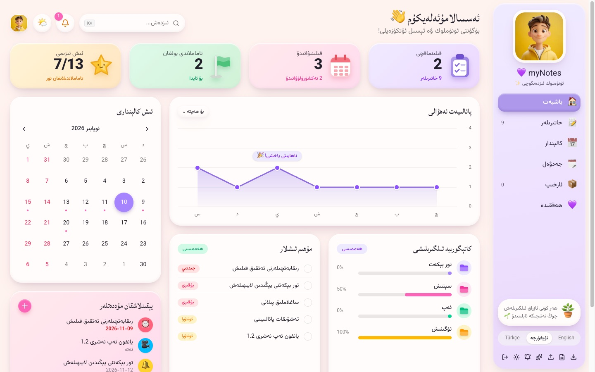
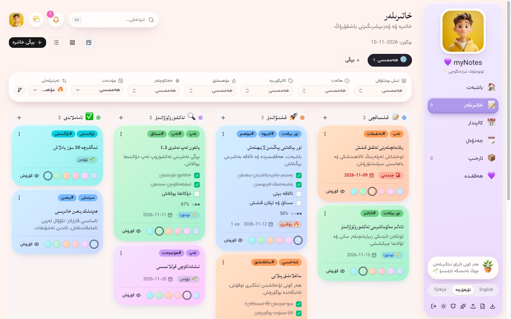
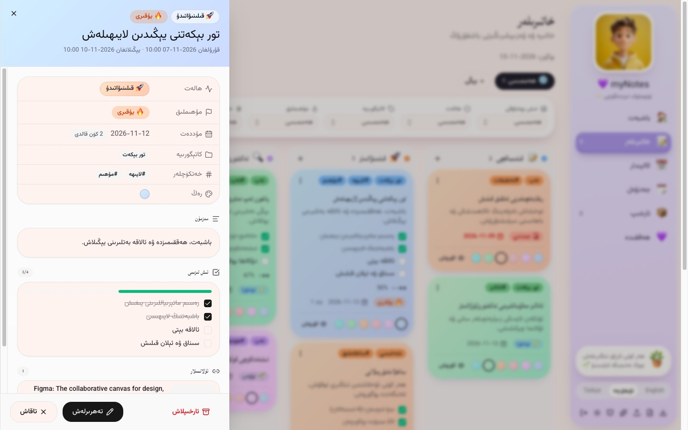
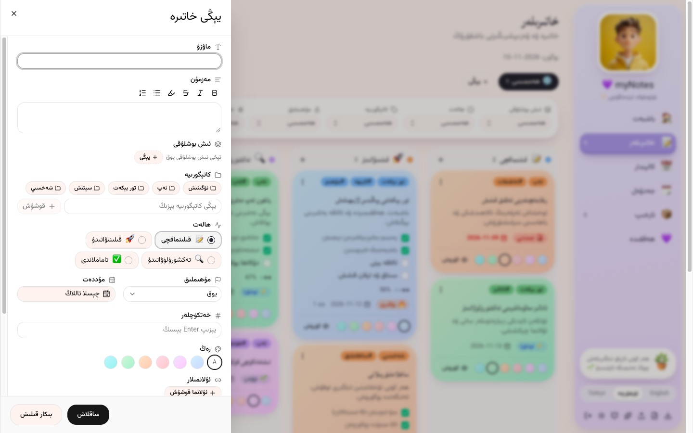
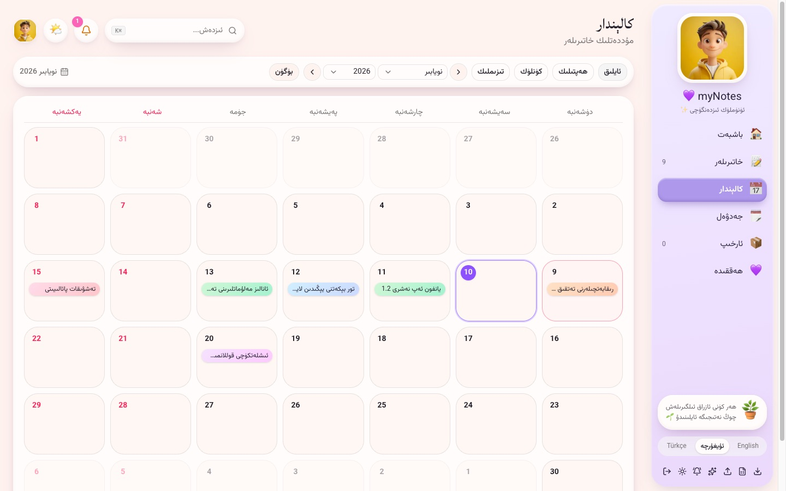
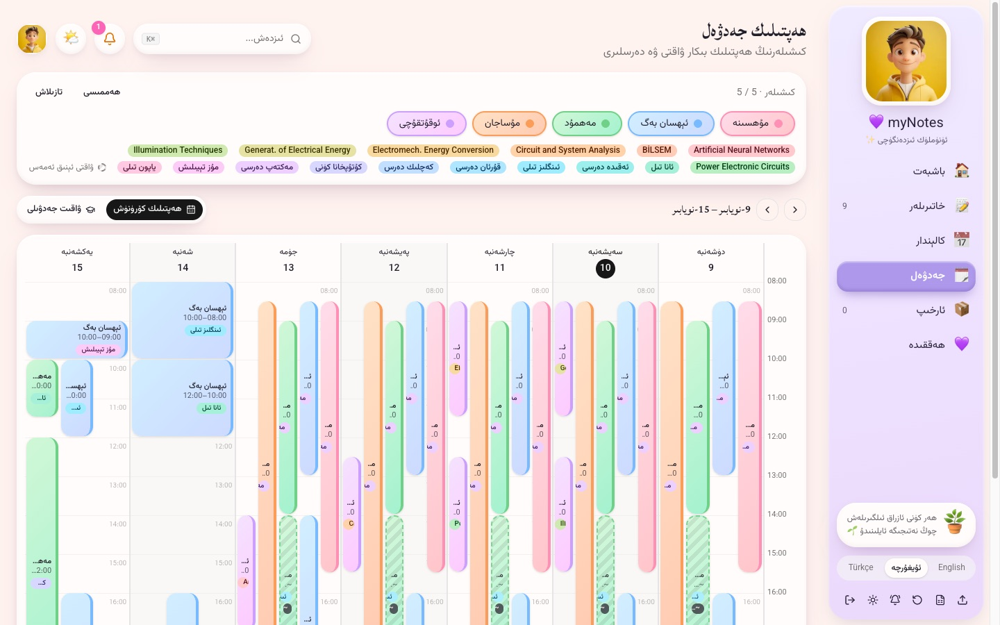
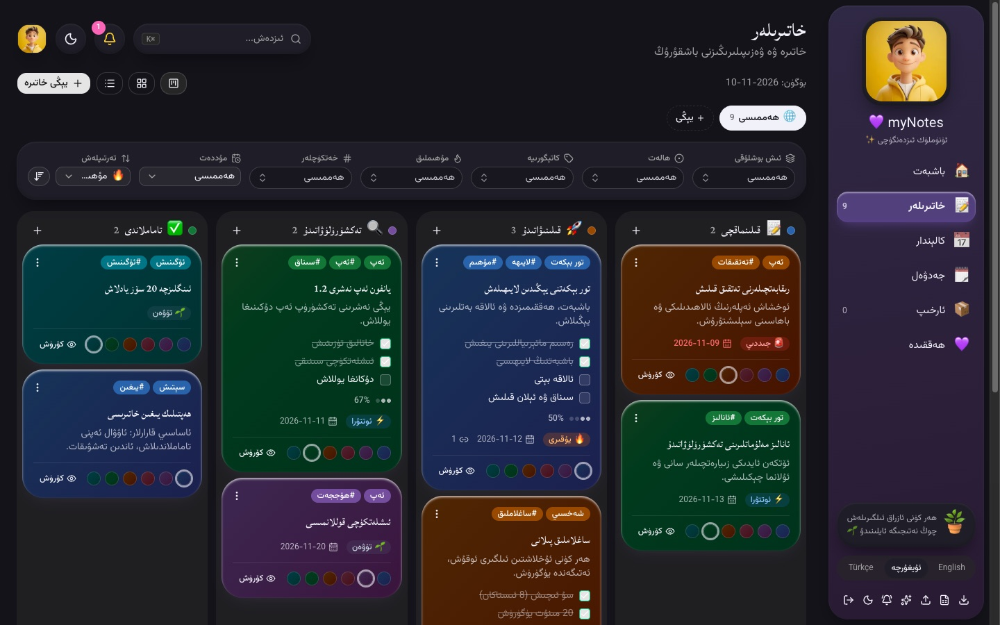
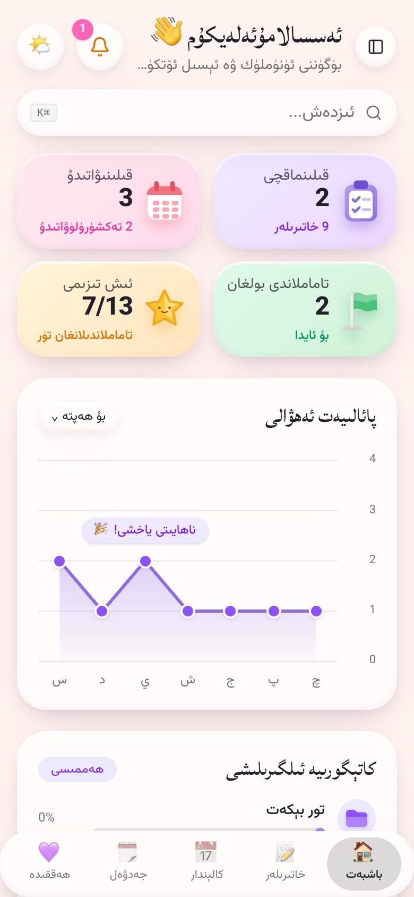
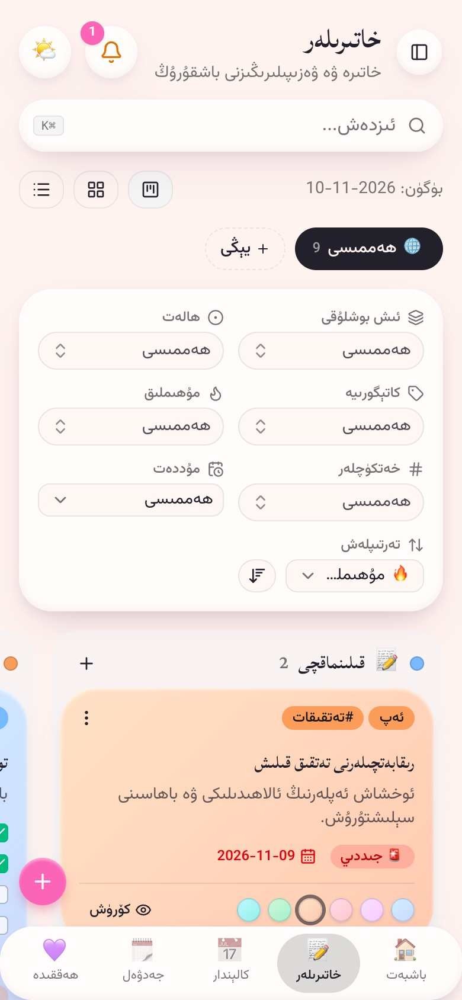
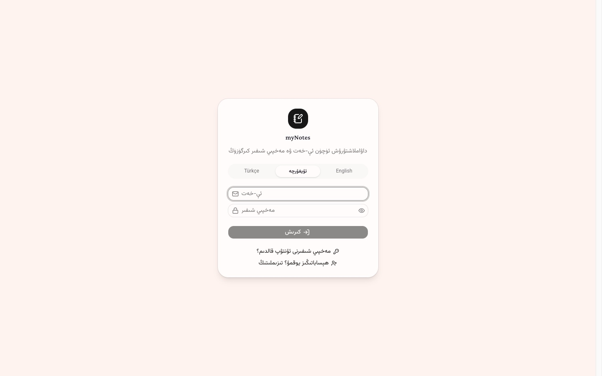

<div align="center">

# 📝 myNotes

**شەخسىي خاتىرە، كانبان، كالېندار ۋە ھەپتىلىك جەدۋەل ئەپى — ئۇيغۇرچە (RTL) ئاساس قىلىنغان؛ ئىنگلىزچە ۋە تۈركچىنىمۇ قوللايدۇ.**

[English](README.md) · [Türkçe](README.tr.md) · **ئۇيغۇرچە**



</div>

---

<div dir="rtl">

## مۇندەرىجە

- [ئىقتىدارلار](#ئىقتىدارلار)
- [ئېكران كۆرۈنۈشلىرى](#ئېكران-كۆرۈنۈشلىرى)
- [تېخنىكىلار](#تېخنىكىلار)
- [ئورنىتىش](#ئورنىتىش)
- [Supabase تەڭشەش](#supabase-تەڭشەش)
- [ئەسكەرتىش (Push)](#ئەسكەرتىش-push)
- [قانداق ئىشلەيدۇ؟](#قانداق-ئىشلەيدۇ)
- [تىللار ۋە RTL](#تىللار-ۋە-rtl)
- [تۈر قۇرۇلمىسى](#تۈر-قۇرۇلمىسى)
- [بۇيرۇقلار ۋە سىناقلار](#بۇيرۇقلار-ۋە-سىناقلار)
- [تارقىتىش](#تارقىتىش)
- [بىخەتەرلىك ئەسكەرتىشلىرى](#بىخەتەرلىك-ئەسكەرتىشلىرى)
- [ئىشلەپچىقىرىش ئەسكەرتىشلىرى](#ئىشلەپچىقىرىش-ئەسكەرتىشلىرى)

## ئىقتىدارلار

**خاتىرىلەر**
- ئۈچ خىل كۆرۈنۈش: **كانبان** (ئىستونلار ئارىسىدا سۆرەپ يۆتكەش)، **كارتا** ۋە **تىزىملىك**.
- تۆت ھالەت (*قىلىنماقچى ← قىلىنىۋاتىدۇ ← تەكشۈرۈلۈۋاتىدۇ ← تاماملاندى*)، تۆت مۇھىملىق دەرىجىسى، مۇددەت، كاتېگورىيە، خەتكۈچ ۋە ھەر بىر خاتىرىگە رەڭ.
- خاتىرە مەزمۇنىدا فورماتلىق تېكىست: **قېلىن**، *يانتۇ*، ~~سىزىلغان~~، ==ئاجرىتىلغان==، چېكىتلىك ۋە نومۇرلۇق تىزىملىك.
- ئىلگىرىلەشنى كۆرسىتىدىغان ئىش تىزىمى (checklist)، ئۇلانمىلار ۋە **رەسىم / PDF قوشۇمچە ھۆججەتلىرى** (مەخپىي Supabase Storage bucket).
- ئىش بوشلۇقى، ھالەت، كاتېگورىيە، مۇھىملىق، خەتكۈچ ۋە مۇددەت بويىچە سۈزۈش؛ ئاخىرقى يېڭىلاش، مۇددەت، مۇھىملىق، ماۋزۇ ياكى **ئۆزى تەرتىپلەش** (كارتا ۋە كانبان كۆرۈنۈشىدە سۆرەپ) بويىچە تەرتىپلەش.
- **ئىش بوشلۇقى**: ئۈستۈنكى كاتېگورىيە (مەسىلەن *شەخسىي*، *مەكتەپ*، *پروۋېكت*)؛ بەتكۈچ سۈپىتىدە كۆرۈنىدۇ.
- ئۆچۈرۈشنىڭ ئورنىغا **ئارخىپلاش**؛ ئارخىپلانغان خاتىرىنى كېيىن ئەسلىگە كەلتۈرگىلى بولىدۇ.
- ئومۇمىي ئىزدەش / بۇيرۇق تاختىسى (`⌘K` / `Ctrl K`).
- **JSON** ياكى **CSV** سۈپىتىدە كىرگۈزۈش ۋە چىقىرىش.

**باشبەت (dashboard)**
- ساناقلار (قىلىنماقچى / قىلىنىۋاتىدۇ / تاماملانغان / ئىش تىزىمى تۈرلىرى)، ھەپتىلىك پائالىيەت جەدۋىلى، ئىش كالېندارى، يېقىنلاشقان مۇددەتلەر، كاتېگورىيە ئىلگىرىلىشى ۋە مۇھىم ئىشلار.
- بوش ھېسابات ئۈچۈن بىر چېكىشتە سىناق (demo) خاتىرىلەر.

**كالېندار**
- مۇددىتى بار بارلىق خاتىرىنىڭ *ئايلىق*، *ھەپتىلىك*، *كۈنلۈك* ۋە *تىزىملىك* كۆرۈنۈشى؛ «بۇ كۈنگە خاتىرە قوشۇش» تېز كۇنۇپكىسى.

**ھەپتىلىك جەدۋەل**
- كىشىلەر ۋە ئۇلارنىڭ ھەر ھەپتە تەكرارلىنىدىغان دەرسلىرى: مەزگىل، ئۆتكۈزۈۋېتىلگەن كۈنلەر، تاللاشچان «ۋاقتى ئېنىق ئەمەس» بەلگىسى ۋە ئىزاھات.
- تاللانغان كىشىلەرنىڭ **ئورتاق بوش ۋاقتىنى** كۆرسىتىدۇ؛ ھەر كۈنىنىڭ بىرىنچى دەرسىدىن ئىلگىرى ۋە ئاخىرقى دەرسىدىن كېيىن **يول ۋاقتى** قوشىدۇ.
- *ھەپتىلىك* ۋە *ۋاقىت جەدۋىلى* كۆرۈنۈشى، CSV كىرگۈزۈش / چىقىرىش، ئۈسكۈنىلەر ئارا ھەقىقىي ۋاقىتتا ماسلاشتۇرۇش.

**ئەسكەرتىش (Web Push)**
- ھېسابات دائىرىسىدىكى **مۇددەت ئەسكەرتىشى** (مەسىلەن مۇددەت كۈنى ۋە 1 كۈن ئىلگىرى، سىز تاللىغان ۋاقىتتا).
- ھەر بىر خاتىرىگە خاس **ئەسكەرتىش**: ئېنىق چېسلا-ۋاقىت ۋە تاللاشچان تەكرارلاش (ھەر *n* مىنۇت / سائەت / كۈن / ھەپتە / ئاي).
- ئەپ تاقاقلىق بولسىمۇ ئىشلەيدۇ؛ ئۇقتۇرۇشنى چېكىپ شۇ خاتىرىنى ئاچقىلى بولىدۇ.

**باشقىلار**
- ئې-خەت + مەخپىي شىفىر بىلەن ھېسابات، ئې-خەتنى جەزملەش ۋە مەخپىي شىفىرنى ئەسلىگە كەلتۈرۈش.
- يورۇق / قاراڭغۇ / سىستېما تېما، PWA سۈپىتىدە ئورنىتىش، يانفوندا ئاستىدىكى يول باشلاش بالدىقى ۋە سۆرەپ يېپىلىدىغان يان تاختا.
- كومپيۇتېردا كەڭلىكىنى تەڭشىگىلى بولىدىغان يان تاختا.
- ئۈچ خىل ئارايۈز تىلى — ئۇيغۇرچە (RTL)، ئىنگلىزچە، تۈركچە — خالىغان ۋاقىتتا ئالماشتۇرغىلى بولىدۇ.

## ئېكران كۆرۈنۈشلىرى

### خاتىرە تاختىسى



### خاتىرە تەپسىلاتى ۋە تەھرىرلىگۈچ

<p>
  
  
</p>

### كالېندار ۋە ھەپتىلىك جەدۋەل

<p>
  
  
</p>

### قاراڭغۇ تېما



### يانفون

<p align="center">
  
  &nbsp;&nbsp;
  
  &nbsp;&nbsp;
  
</p>

> ئېكران كۆرۈنۈشلىرىدە ئەپنىڭ ئىچكى سىناق (demo) خاتىرىلىرى ۋە سۈكۈتتىكى سىناق جەدۋىلى ئىشلىتىلدى؛ ھەقىقىي ھېسابات ياكى سانلىق مەلۇمات ئىشلىتىلمىدى.

## تېخنىكىلار

| ساھە | تېخنىكا |
| --- | --- |
| فرېيمۋورك | [Next.js](https://nextjs.org) 16 (App Router، `cacheComponents`، Turbopack)، React 19، TypeScript |
| ئۇسلۇب / ئارايۈز | Tailwind CSS v4، [Base UI](https://base-ui.com) ئاستىدىكى shadcn/ui، lucide-react، sonner، next-themes |
| ئارقا ئۇچ | [Supabase](https://supabase.com): Postgres + Row Level Security، Auth، Storage، Realtime، Edge Functions، `pg_cron` |
| كلىئېنت كۈتۈپخانىلىرى | `@supabase/supabase-js`، `@dnd-kit` (سۆرەش)، `cmdk`، `date-fns`، `react-day-picker`، `zod` |
| Push | Service worker ۋە Supabase Edge Function (Deno) ئارقىلىق Web Push (VAPID) |

## ئورنىتىش

**تەلەپ:** Node.js 20.9 ياكى ئۇنىڭدىن يۇقىرى نەشرى ۋە ھەقسىز [Supabase](https://supabase.com) تۈرى.

</div>

```bash
git clone <fork-or-repo-url> myNotes
cd myNotes
npm install
cp .env.example .env.local     # تۆۋەندىكى قىممەتلەرنى تولدۇرۇڭ
npm run dev                    # http://localhost:3000
```

<div dir="rtl">

### مۇھىت ئۆزگەرگۈچىلىرى

| ئۆزگەرگۈچى | زۆرۈر | چۈشەندۈرۈش |
| --- | --- | --- |
| `NEXT_PUBLIC_SUPABASE_URL` | ھەئە | Supabase ← *Project Settings → API* ← Project URL |
| `NEXT_PUBLIC_SUPABASE_ANON_KEY` | ھەئە | پەقەت **anon / public** ئاچقۇچ. `service_role` ئاچقۇچىنى بۇ يەرگە **ھەرگىز** قويماڭ — ئۇ RLS نى بىكار قىلىدۇ |
| `NEXT_PUBLIC_VAPID_PUBLIC_KEY` | push ئۈچۈن | `npx web-push generate-vapid-keys` ئارقىلىق جۈپ ھاسىل قىلىڭ. بۇ يەرگە پەقەت **public** ئاچقۇچ يېزىلىدۇ |

Supabase ئۆزگەرگۈچىلىرى بولمىسا، ئەپ «تەڭشەلمىگەن» دېگەن ئاگاھلاندۇرۇش بىلەن كىرىش ئېكرانىنى كۆرسىتىدۇ.

## Supabase تەڭشەش

1. تۈر قۇرۇڭ، ئاندىن *Authentication → Providers* ئاستىدا **Email** نى ئېچىڭ.
2. *Authentication → URL Configuration* ئاستىدا **Site URL** نى (ۋە قايتۇرۇش ئادېرسلىرىنى) ئەپ ئىجرا بولىۋاتقان ئادېرسقا تەڭشەڭ؛ شۇنداق قىلغاندا جەزملەش ۋە مەخپىي شىفىر ئەسلىگە كەلتۈرۈش ئۇلانمىلىرى ئەپكە قايتىدۇ.
3. **SQL Editor** نى ئېچىپ، [`supabase/migrations/`](supabase/migrations) ئىچىدىكى ھۆججەتلەرنى **تەرتىپ بويىچە** ئىجرا قىلىڭ:

| ھۆججەت | نېمە قىلىدۇ؟ |
| --- | --- |
| `0001_init.sql` | `notes`، `schedule_people`، `schedule_lessons` جەدۋەللىرى، مەخپىي `attachments` bucket، RLS قائىدىلىرى |
| `0002_schedule_realtime.sql` | جەدۋەل ساندانلىرىنى Realtime غا قوشىدۇ |
| `0003_workspaces.sql` | ئىش بوشلۇقى ۋە `notes.workspace_id`؛ بار خاتىرىلەرنى سۈكۈتتىكى ئىش بوشلۇقىغا يۆتكەيدۇ |
| `0004_archive.sql` | ئارخىپ ئۈچۈن `notes.archived_at` |
| `0005_reminders.sql` | Push مۇشتەرىلىكى، ئەسكەرتىش تەڭشىكى ۋە ئەۋەتىلگەنلەر خاتىرىسى (+ `pg_cron` ئۈلگىسى) |
| `0006_note_reminders.sql` | خاتىرىگە خاس ئەسكەرتىش (`notes.reminders`) ۋە خاتىرە تازىلاش |
| `0007_email_exists.sql` | مەخپىي شىفىر ئەسلىگە كەلتۈرۈش فورمىسى ھېساباتنىڭ بار-يوقلۇقىنى ئېيتالىشى ئۈچۈن `email_exists()` |
| `0008_rls_initplan.sql` | تېز RLS قائىدىلىرى (`(select auth.uid())` ھەر سوراققا بىر قېتىم ھېسابلىنىدۇ) |

بىراۋزېر كلىئېنتى پەقەت anon ئاچقۇچنى ئىشلىتىدۇ. ھەر بىر جەدۋەلدە RLS بار؛ ئىشلەتكۈچى **پەقەت ئۆز قۇرلىرىنى** ئوقۇيالايدۇ ۋە يازالايدۇ. قوشۇمچە ھۆججەتلەر `attachments/{user_id}/{attachment_id}` يولىدا ساقلىنىدۇ.

## ئەسكەرتىش (Push)

ئىككى خىل ئەسكەرتىشنى، `pg_cron` ھەر مىنۇتتا چاقىرىدىغان [`send-reminders`](supabase/functions/send-reminders) Edge Function ئەۋەتىدۇ:

- **مۇددەت ئەسكەرتىشى** — ھېسابات دائىرىسىدىكى تەڭشەك (مۇددەتتىن قانچە كۈن ئىلگىرى + كۈندىكى ۋاقىت + ۋاقىت بەلبېغى).
- **خاتىرە ئەسكەرتىشى** — ھەر بىر خاتىرىگە ئېنىق چېسلا/ۋاقىت، تاللاشچان تەكرارلاش.

</div>

```bash
# 1) فۇنكسىيەنى يوللاڭ (چاقىرغۇچىنى ئۆزى تەكشۈرىدۇ: cron secret ياكى ئىشلەتكۈچىنىڭ JWT ى)
supabase functions deploy send-reminders --no-verify-jwt

# 2) Secret لار
supabase secrets set \
  VAPID_PUBLIC_KEY=...  VAPID_PRIVATE_KEY=...  VAPID_SUBJECT=mailto:you@example.com \
  CRON_SECRET=...
```

<div dir="rtl">

3. `pg_cron` ۋە `pg_net` كېڭەيتىلمىلىرىنى ئېچىڭ (*Database → Extensions*).
4. ئوخشاش مەخپىي قىممەتنى Vault قا ساقلاڭ: `select vault.create_secret('<same-secret>', 'reminders_cron_secret');`
5. `0006_note_reminders.sql` ئىچىدىكى `cron.schedule('send-reminders', '* * * * *', …)` ئۈلگىسىنى ئىجرا قىلىڭ؛ `<project-ref>` نىڭ ئورنىغا ئۆز تۈرىڭىزنىڭ پايدىلىنىش نومۇرىنى يېزىڭ.

ئەپتە: يان بالداق ← **ئەسكەرتىش** ← ئۇقتۇرۇشنى ئېچىڭ، كۈن ۋە ۋاقىتنى تاللاڭ، *سىناق ئۇقتۇرۇشى ئەۋەتىش* نى بېسىڭ. iPhone دا ئالدى بىلەن ئەپنى ئاساسىي ئېكرانغا قوشۇڭ (iOS web push نى پەقەت ئورنىتىلغان تور ئەپلىرىگە يەتكۈزىدۇ).

> `due.ts` ۋە `occurrence.ts` Edge Function بىلەن بىراۋزېر ئارىسىدا ئورتاق ئىشلىتىلىدۇ؛ شۇڭا ئۇلاردا **ھېچقانداق import بولماسلىقى** كېرەك.

## قانداق ئىشلەيدۇ؟

- **خاتىرە ماسلاشتۇرۇش** — `lib/notes-store.tsx` ئالدىن يېڭىلايدىغان (optimistic) reducer ساقلايدۇ؛ ئۆزگىرىشلەر ئاخىرقى مۇلازىمېتىر كۆرۈنمە سۈرىتى بىلەن سېلىشتۇرۇلۇپ، پارچىلىق `upsert` قىلىنىدۇ. باشقا ئۈسكۈنىلەردىكى ئۆزگىرىشلەر Supabase Realtime ئارقىلىق كېلىدۇ.
- **جەدۋەل ۋە ئىش بوشلۇقى** — `lib/schedule-store.ts` ۋە `lib/workspaces-store.ts` ئوخشاش «پەرقنى ئېلىپ ماسلاشتۇرۇش» لوگىكىسىنى Realtime بىلەن ئىشلىتىدۇ.
- **قوشۇمچە ھۆججەت** — `lib/blobs.ts` Supabase Storage غا يۈكلەيدۇ، چۈشۈرگەنلەرنى IndexedDB دا كەشلەيدۇ.
- **تۇنجى قېتىم كىرىش** — بوش ھېساباتقا بىر قېتىم demo خاتىرىلەر قوشۇلىدۇ (ئىشلەتكۈچى metadata سىدىكى بەلگە قايتا قوشۇلۇشنىڭ ئالدىنى ئالىدۇ).
- **ئارايۈز تەڭشەكلىرى** (كۆرۈنۈش، تەرتىپ، سۈزگۈچ، تاختا كەڭلىكى، تىل) `localStorage` دا ساقلىنىدۇ.
- **Service worker** — `public/sw.js` پەقەت push نى بىر تەرەپ قىلىدۇ؛ قەستەن كەش ئىشلەتمەيدۇ، شۇڭا كونا بەت كۆرۈنمەيدۇ.

## تىللار ۋە RTL

بارلىق ئارايۈز تېكىستلىرى [`lib/i18n/`](lib/i18n) ئىچىدە: `ug.ts` (ئۇيغۇرچە، `Messages` تىپىنىڭ مەنبەسى)، `en.ts` ۋە `tr.ts`. يېڭى تېكىست قوشقاندا **ئۈچ ھۆججەتكىمۇ** قوشۇڭ — بىرى كەم بولسا TypeScript ئاگاھلاندۇرىدۇ.

ئۇيغۇرچە ئوڭدىن سولغا، ئىنگلىزچە ۋە تۈركچە سولدىن ئوڭغا كۆرۈنىدۇ. ساقلانغان تىل تۇنجى سىزىلىشتىن *ئىلگىرى* ئىچكى بىر سكرىپت ئارقىلىق `<html lang dir>` غا يېزىلىدۇ؛ شۇڭا بەت خاتا يۆنىلىشتە چاقنىمايدۇ. ئورۇنلاشتۇرۇش لوگىكىلىق خاسلىقلارنى (`ms-*`, `pe-*`, `text-start`, …) ئىشلىتىدىغاچقا، ئۆزلۈكىدىن ئەكس ئەتتۈرۈلىدۇ؛ يان تاختا RTL دا سولدىن، LTR دا ئوڭدىن ئېچىلىدۇ.

## تۈر قۇرۇلمىسى

</div>

```
app/                    Next.js App Router
  (app)/                كىرگەندىن كېيىنكى بەتلەر: / (باشبەت), notes, calendar, schedule, archive, about
  api/og/               Open Graph رەسىمى
  manifest.ts           PWA manifest
components/
  auth/                 كىرىش / تىزىملىتىش / مەخپىي شىفىر ئەسلىگە كەلتۈرۈش, AuthGate
  notes/                ئىقتىدار كومپونېنتلىرى (kanban, card, list, dialog, calendar, schedule, …)
  ui/                   shadcn/ui قىسىملىرى, SidePanel
hooks/                  كىچىك React hook لىرى
lib/
  i18n/                 ug / en / tr تېكىستلىرى
  notes-*.ts(x)         خاتىرە store + Supabase repo
  schedule-*.ts         جەدۋەل store, repo, CSV
  supabase/client.ts    پەقەت بىراۋزېردا ئىشلەيدىغان Supabase كلىئېنتى
public/                 سىنبەلگىلەر, service worker
supabase/
  migrations/           SQL، تەرتىپ بويىچە ئىجرا قىلىنىدۇ
  functions/send-reminders/   Edge Function + ئورتاق چېسلا لوگىكىسى + سىناقلار
docs/screenshots/       README رەسىملىرى (ug / en / tr)
```

<div dir="rtl">

## بۇيرۇقلار ۋە سىناقلار

| بۇيرۇق | مەقسىتى |
| --- | --- |
| `npm run dev` | 3000-ئېغىزدا تەرەققىيات (development) مۇلازىمېتىرى |
| `npm run build` | Production build |
| `npm start` | Production build نى ئىجرا قىلىدۇ |
| `npm run lint` | ESLint |
| `node --test supabase/functions/send-reminders/*.test.ts` | ئەسكەرتىش لوگىكىسىنىڭ بىرلىك سىنىقى (TypeScript نى بىۋاسىتە ئىجرا قىلالايدىغان Node 22.18+ ياكى 23.6+ كېرەك) |

ئالدى تەرەپ (front end) ئۈچۈن تەڭشەلگەن سىناق ئىجراچىسى يوق.

## تارقىتىش

بۇ ئادەتتىكى Next.js ئەپى: repo نى Railway، Vercel ياكى ھەر قانداق Node مۇلازىمېتىرىغا ئۇلاڭ، ئۈچ `NEXT_PUBLIC_*` ئۆزگەرگۈچىنى تەڭشەپ، `npm run build` / `npm start` نى ئىجرا قىلىڭ. ئەپتە كۆرۈنىدىغان نەشر نومۇرى `package.json` دىكى `major.minor` ۋە git commit سانىدىن ھاسىل بولىدۇ (`APP_VERSION` ئارقىلىق ئۆزگەرتكىلى بولىدۇ).

## بىخەتەرلىك ئەسكەرتىشلىرى

- بىراۋزېرغا پەقەت **anon** ئاچقۇچ يەتكۈزۈلىدۇ؛ سانلىق مەلۇماتنى **Row Level Security** قوغدايدۇ.
- `send-reminders` فۇنكسىيەسى `--no-verify-jwt` بىلەن يوللىنىدۇ ۋە تەلەپلەرنى ئۆزى دەلىللەيدۇ (cron ئۈچۈن `x-cron-secret`، سىناق ئۇقتۇرۇشى ئۈچۈن ئىشلەتكۈچىنىڭ JWT ى). `CRON_SECRET` ۋە VAPID **private** ئاچقۇچىنى پەقەت Edge Function secret لىرىدا ساقلاڭ.
- `email_exists()` مەخپىي شىفىر ئەسلىگە كەلتۈرۈش فورمىسىنىڭ ھېساباتنىڭ بار-يوقلۇقىنى ئېيتىشىغا يول قويىدۇ. بۇ ھېسابات بارلىقىنى سۈرۈشتۈرۈشكە ئىمكان بېرىدۇ — Supabase نىڭ بىتەرەپ ھالىتىنى ياقتۇرسىڭىز، `0007` migration ۋە ئۇنىڭغا ئالاقىدار ئارايۈزنى ئۆچۈرۈڭ.

## ئىشلەپچىقىرىش ئەسكەرتىشلىرى

- بۇ تۈر كۆپ قوللانمىلارغا قارىغاندا بۇزغۇچى ئۆزگىرىشلىرى بار Next.js نەشرىنى ئىشلىتىدۇ. Next.js كودى يېزىشتىن بۇرۇن `node_modules/next/dist/docs/` ئىچىدىكى مۇناسىۋەتلىك قوللانمىنى ئوقۇڭ ([AGENTS.md](AGENTS.md)).
- [`next.config.ts`](next.config.ts) دا `cacheComponents` ۋە `partialPrefetching` ئوچۇق؛ سانلىق مەلۇمات ئېلىش ياكى دىنامىك API قوشۇشتىن بۇرۇن قوللانمىغا قاراڭ.
- Tailwind ئادەتتىكى PostCSS تەڭشىكىنىڭ ئورنىغا Turbopack ئارقىلىق ئىشلەيدۇ (`next.config.ts` دىكى `turbopack.rules`)؛ ئۇسلۇبلار `app/globals.css` ئىچىدە.
- `html` ھەمىشە تىك سىيرىلما بالداق كۆرسىتىدۇ (`overflow-y: scroll !important`) ۋە دىئالوگ ئوچۇق ۋاقىتتا `PageScrollGuard` بەتنىڭ سىيرىلىشىنى توسىدۇ؛ شۇنداق قىلىپ دىئالوگ، تاللاش رامكىسى ياكى تاختا ئېچىلغاندا ئورۇنلاشتۇرۇش سۈرۈلۈپ كەتمەيدۇ.

</div>
